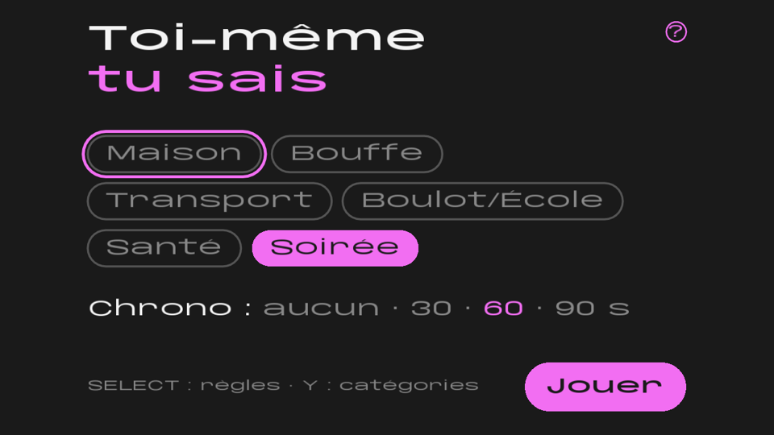
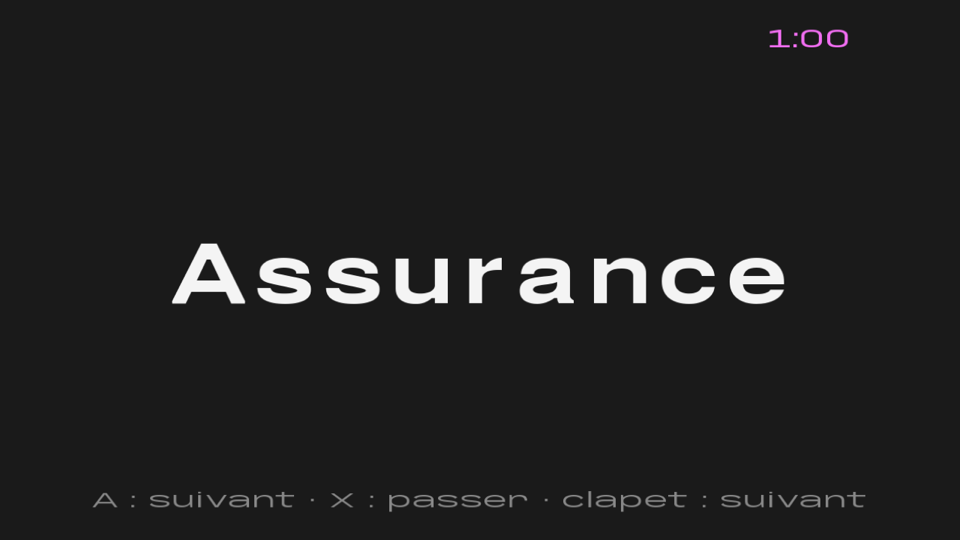
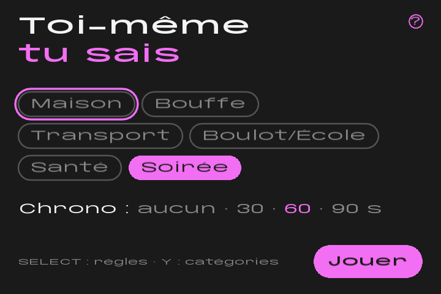
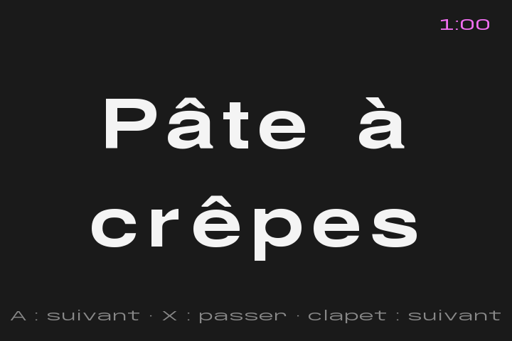

<h1 align="center">Toi-même tu sais</h1>

<b>A French party game about the memories you share.</b> 
By LAFLEURSTUDIO · Web · Phone · AYN Thor · Anbernic RG SP

  <a href="https://jonlekern.github.io/Toi-meme-tu-sais/"><b>▶ Play online</b></a> ·
  <a href="https://github.com/Jonlekern/Toi-meme-tu-sais/releases/latest"><b>AYN Thor app</b></a> ·
  <a href="#3-anbernic-rg-sp"><b>Anbernic RG SP</b></a>

  
  

## How to play

Play in pairs while the others listen.

1. A word from everyday life appears, and only one of you looks at it.
2. Make your partner guess it **only by recalling something you lived together**:
   *« Tu te rappelles hier soir, j'étais pas bien, tu m'as dit de prendre un truc… »*
   → *« Doliprane ! »*
3. The other team listens and can try to guess too.
4. Found it? Next word. Too hard? Skip it.

The others hear clues that make no sense to them, while you two just know.
*De toi-même tu sais.*

## What's inside

- **~900 everyday French words**: a base list of ~500, plus 6 categories you can tick:
  Maison, Bouffe, Transport, Boulot/École, Santé and Soirée (a bit spicier).
- **A hidden die** slips a word from your ticked categories in every 2, 3 or 4 words.
- **No word comes back** until its whole pile has been used.
- **Optional timer**: 30, 60 or 90 seconds. No score, just fun.
- **Your own categories**: create them and type your own words in the game.
  The console has an on-screen AZERTY keyboard. On the web you can also paste a
  whole list (one word per line, or separated by commas) and edit it in one go.
- **Rules card** one tap away (the « ? » button).

## Get the game

### 1. Web app (phone and computer)

**[▶ jonlekern.github.io/Toi-meme-tu-sais](https://jonlekern.github.io/Toi-meme-tu-sais/)**

Plays in any browser, with mouse, keyboard or touch. On a phone it switches to
an upright layout with big buttons, swipes and the sticky note. To keep it on
your home screen, follow the install steps the page shows (Share › Add to Home
Screen on iPhone, ⋮ › Install app on Android).

  
  

### 2. AYN Thor (Android app)

**[⬇ Download the APK from the latest release](https://github.com/Jonlekern/Toi-meme-tu-sais/releases/latest)**

1. On the Thor, open the link above in the browser.
2. Download the `.apk` file and open it.
3. Allow installing from the browser when Android asks, then tap Install.

Buttons and touch both work. Close and reopen the lid to get a new word. The
bottom screen shows the timer: time left, Pause, Recommencer, and the duration
(none, 30, 60 or 90 s), which you can change during play. Start the game from
the top screen.

  
  

### 3. Anbernic RG SP

Runs on ROCKNIX, in the Ports menu. It is copied to the console over the
network (see [Console build](#console-build) below). Close and reopen the lid to
get a new word. An on-screen AZERTY keyboard lets you type your own words, and
every word shown is saved to `stats.txt` for later statistics.

  
  

  

## Controls

| Action | Phone | Computer | AYN Thor | RG SP |
|---|---|---|---|---|
| Next word | Tap or swipe right | Click, Space, Enter or drag right | A, tap, swipe right, or close and reopen the lid | A, or close and reopen the lid |
| Previous word | Swipe left | Drag left | Swipe left | — |
| Skip word | Swipe right (same as next) | P | X | X |
| Hide the word (sticky note) | Long press; swipe up or long press on it to peel it off | Long press; drag up or long press on it to peel it off | Long press; swipe up or long press on it to peel it off | — |
| Rules | « ? » | ? | SELECT or « ? » | SELECT |
| My categories | « Mes catégories » | C | Y | Y |
| Back | « ‹ Retour » | Escape | B | B |

---

## For developers

Built with [LÖVE](https://love2d.org/) 11.5. The game logic lives in `src/` as
pure Lua and is tested with LuaJIT:

    luajit tests/run.lua

Run on a computer, from the project root:

    love .

### Web build

Needs [Node.js](https://nodejs.org/) (for `npx`) and `zip`:

    tools/build_web.sh <output-dir>

This packages the game with love.js 11.4.1 in compatibility mode. The result is
a static site that can be served as-is over HTTPS.

### Android build (AYN Thor)

The workflow `.github/workflows/android.yml` packages the game with LÖVE for
Android 11.5 and signs the APK. Push a tag such as `v1.0.1` to publish it on
the Releases page. To install on the device: open the latest release in the
device's browser, download the `.apk`, open it and allow installing from the
browser when Android asks.

### Console build

1. On the console, enable Samba (START > Network Settings > Enable Samba).
2. Point the build at a folder holding an aarch64 LÖVE 11.5 binary and its `libs/`:
   `LOVE_BIN_DIR` (or the first line of `build/love-bin-dir`), and `LOVE_BIN_NAME`
   for the binary's file name (default `lafleur-ui`).
3. `tools/install_console.sh` shows what it would do (dry run);
   `tools/install_console.sh --yes` builds the port and copies it to
   `/storage/roms/ports`, backing up any file it replaces.
4. On the console: START > Game Settings > Update Gamelists, then Ports.

## Fonts

Clebard (words), Calebard (interface) and Espresso 4.40.- (sticky note) by
LAFLEURSTUDIO, from
[jonlekern.github.io/Fonts](https://jonlekern.github.io/Fonts/). Their licence
files are in `assets/fonts/`.

## Licence

© 2026 LAFLEURSTUDIO. **All rights reserved.** You may play the game and read
the code, but not copy, modify, redistribute or sell it without written
permission. See [LICENSE](LICENSE).
