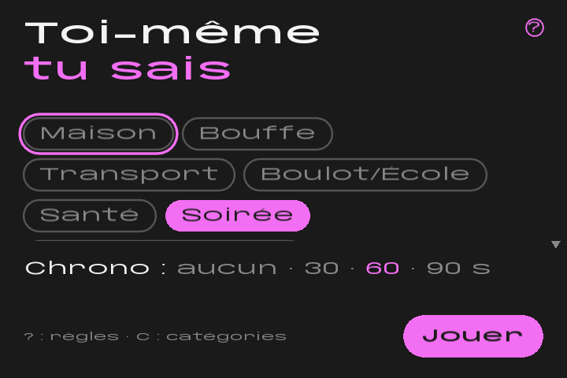
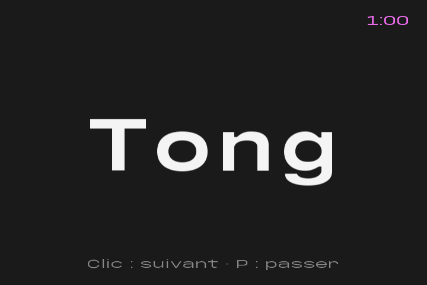
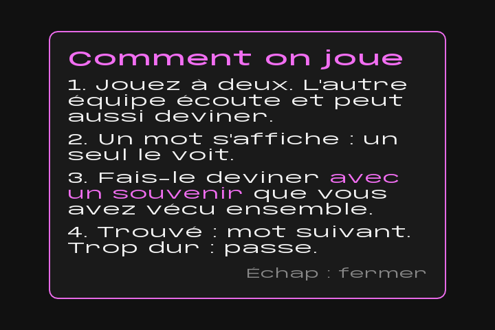
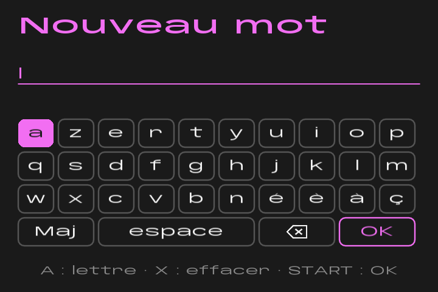
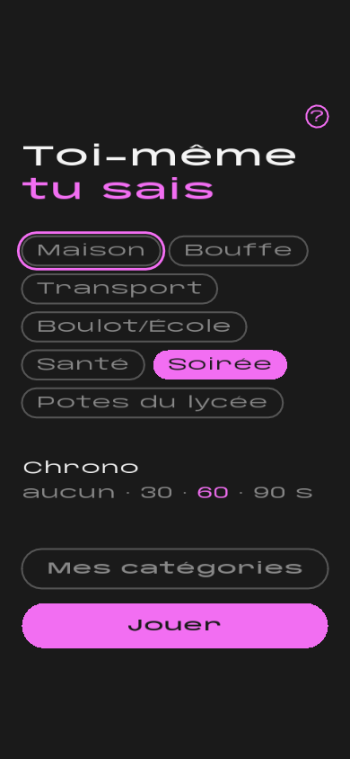
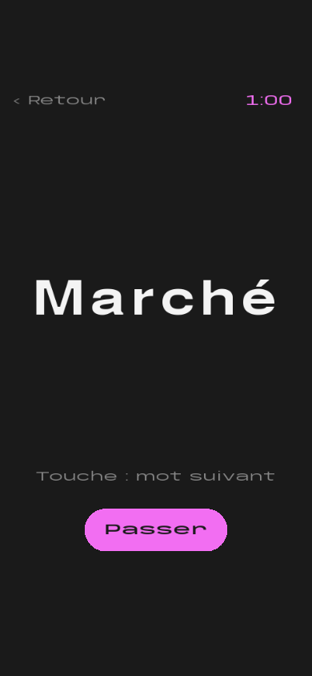

<h1 align="center">Toi-même tu sais</h1>

<b>A French party game about the memories you share.</b> 
By LAFLEURSTUDIO · Anbernic RG SP · Web · Phone

<a href="https://jonlekern.github.io/Toi-meme-tu-sais/"><b>▶ Play online</b></a>

  
  

## How to play

Play in pairs while the others listen.

1. A word from everyday life appears, and only one of you looks at it.
2. Make your partner guess it **only by recalling something you lived together**:
   *« Tu te rappelles hier soir, j'étais pas bien, tu m'as dit de prendre un truc… »*
   → *« Doliprane ! »*
3. The other team listens and can try to guess too.
4. Found it? Next word. Too hard? Skip it.

The others hear clues that make no sense to them, while you two just know.
*De toi-même tu sais.*

## What's inside

- **~900 everyday French words**: a base list of ~500, plus 6 categories you can tick:
  Maison, Bouffe, Transport, Boulot/École, Santé and Soirée (a bit spicier).
- **A hidden die** slips a word from your ticked categories in every 2, 3 or 4 words.
- **No word comes back** until its whole pile has been used.
- **Optional timer**: 30, 60 or 90 seconds. No score, just fun.
- **Your own categories**: create them and type your own words in the game.
  The console has an on-screen AZERTY keyboard. On the web you can also paste a
  whole list (one word per line, or separated by commas) and edit it in one go.
- **Rules card** one tap away (the « ? » button).

## Platforms

| | |
|---|---|
| **Anbernic RG SP (ROCKNIX)** | In the Ports menu. Close and reopen the lid to get a new word. Every word shown is saved to `stats.txt` for later statistics. |
| **Web** | Plays in any browser with mouse, keyboard or touch: [jonlekern.github.io/Toi-meme-tu-sais](https://jonlekern.github.io/Toi-meme-tu-sais/). |
| **Phone** | The web version switches to an upright layout with big buttons. |

  
  
  

## Controls

| Action | RG SP | Computer | Phone |
|---|---|---|---|
| Next word | A, or close and reopen the lid | Click, Space, Enter or drag right | Tap or swipe right |
| Previous word | — | Drag left | Swipe left |
| Skip word | X | P | Swipe right (same as next) |
| Hide the word (sticky note) | — | Long press, drag up to peel it off | Long press, swipe up to peel it off |
| Rules | SELECT | ? | « ? » |
| My categories | Y | C | « Mes catégories » |
| Back | B | Escape | « ‹ Retour » |

---

## For developers

Built with [LÖVE](https://love2d.org/) 11.5. The game logic lives in `src/` as
pure Lua and is tested with LuaJIT:

    luajit tests/run.lua

Run on a computer, from the project root:

    love .

### Web build

Needs [Node.js](https://nodejs.org/) (for `npx`) and `zip`:

    tools/build_web.sh <output-dir>

This packages the game with love.js 11.4.1 in compatibility mode. The result is
a static site that can be served as-is over HTTPS.

### Console build

1. On the console, enable Samba (START > Network Settings > Enable Samba).
2. Point the build at a folder holding an aarch64 LÖVE 11.5 binary and its `libs/`:
   `LOVE_BIN_DIR` (or the first line of `build/love-bin-dir`), and `LOVE_BIN_NAME`
   for the binary's file name (default `lafleur-ui`).
3. `tools/install_console.sh` shows what it would do (dry run);
   `tools/install_console.sh --yes` builds the port and copies it to
   `/storage/roms/ports`, backing up any file it replaces.
4. On the console: START > Game Settings > Update Gamelists, then Ports.

## Fonts

Clebard (words), Calebard (interface) and Espresso 4.40.- (sticky note) by
LAFLEURSTUDIO, from
[jonlekern.github.io/Fonts](https://jonlekern.github.io/Fonts/). Their licence
files are in `assets/fonts/`.

## Licence

© 2026 LAFLEURSTUDIO. **All rights reserved.** You may play the game and read
the code, but not copy, modify, redistribute or sell it without written
permission. See [LICENSE](LICENSE).
